# Hi there, I'm Luis Daniel Rojas Caceres

<table align="center" width="100%">
  <tr>
    <td width="50%" align="center" valign="middle">
      
    </td>
    <td width="50%" align="center" valign="middle">
      
    </td>
  </tr>
</table>

## About Me
Systems Engineering student at **Universidad Católica Boliviana San Pablo** (also studying Computer Science at **UMSA**), based in La Paz, Bolivia.
I build backend systems, databases and AI-powered solutions, and I like taking projects from a hackathon prototype to a real implementation.

- 🥇 **1st place overall** at InnovaHack 2026 (CAINCO) with team NexoLab, now implementing our AI assistant for **Hipermaxi**
- 🌟 **Stellar Elite winner** with WorkVille, selected among the top 50 developers in Bolivia
- ☁️ AWS Certified Cloud Practitioner
- 🗣️ Spanish (native) · English (intermediate)

---

## Connect with Me

---

## Achievements
- 🥇 **InnovaHack 2026 (CAINCO)** — 1st place overall and 1st place in the Business Challenge with team NexoLab. Hipermaxi then contacted us to implement the solution officially.
- 🌟 **Stellar Elite** — Winner with WorkVille, selected among the top 50 developers in Bolivia.
- 🥈 **IPAS Bolivia Hackathon 2025** — 2nd place with an evidence management and legal assistance app, later requested by IPAS Bolivia for development under contract.
- 🥉 **Buildathon, Avalanche challenge** — 3rd place with SeedFi.
- 🥈 **FUNTEC – UCB** — 2nd place at the university technology fair.

---

## Experience

**AI Development & Implementation — Hipermaxi** · *Team NexoLab · 2026 – Present*
Building an AI assistant embedded in Hipermaxi's supplier portal, with chat and voice interaction, contextual guidance and process automation. It started as our winning InnovaHack 2026 project and is now being officially implemented.

**Software Developer — IPAS Bolivia Project** · *2025*
Web and AI solution for evidence management and legal assistance in incident cases. 2nd place at the IPAS Bolivia Hackathon; IPAS later requested the software for contracted development.

**Computer Lab Assistant — Universidad Católica Boliviana San Pablo** · *2025*

---

## Featured Projects

| Project | Description | Stack |
| --- | --- | --- |
| **[WorkVille](https://myworkville.com)** · [repo](https://github.com/ozioziel/Cryptoville) | Freelance marketplace as an interactive 2D village. USDC payments through Soroban escrow contracts (direct, guaranteed and 2–5 milestone payments), arbitrated disputes, KYC and reputation. **Stellar Elite winner.** | Stellar, Soroban, TypeScript |
| **Hipermaxi AI Assistant** · *private* | Embeddable chat and voice assistant for Hipermaxi's supplier portal. **1st place InnovaHack 2026**, currently in production rollout. | AI, RAG, APIs, Web |
| **[MAPIA](https://github.com/daniel69zz/mapia_backend)** | Smart incident map: community reports with geolocation and reliability mechanisms to help people avoid problem areas. | React, NestJS, TypeScript |
| **UCB Sports Hub** · *private* | Sports management system for UCB's Sports Department: users, roles, teams, tournaments, bookings and reports. I designed the unified relational database used by all microservices. | NestJS, React, PostgreSQL, Docker |
| **[Sentinel](https://github.com/daniel69zz/RAG_HACKATON_SENTINEL)** | Evidence management and legal assistance app with AI-assisted incident analysis. **2nd place IPAS Bolivia Hackathon 2025.** | Python, RAG, Flutter |
| **[SeedFi](https://github.com/daniel69zz/seedfi)** | On-chain real estate financing. **3rd place, Avalanche challenge.** | TypeScript, Solidity |
| **[Sign Language Recognition](https://github.com/daniel69zz/sign_language_recognition_v2)** | Machine learning model for sign language gesture recognition. | TensorFlow, OpenCV, MediaPipe |
| **[Coffix](https://coffix-frontend.vercel.app)** · [repo](https://github.com/daniel69zz/COFFIX_FRONTEND) | Transaction processing system for a coffee shop: orders, products and daily operations. | JavaScript, Java |
| **[Mini E-commerce](https://github.com/daniel69zz/mini_ecommerce)** | E-commerce system with product and user management over a REST API. | Node.js, Vue |

---

## Tech Stack

### Languages

  

### Backend & Frameworks

  

### Frontend & Mobile

  

### Databases

  

### AI & Machine Learning

  

### DevOps & Cloud

  

### Tools & Workflow

  

### Also working with

---

## Current Focus
- Taking the Hipermaxi AI assistant to production with NexoLab
- Backend engineering and scalable architectures
- Advanced SQL and database design
- Cloud computing and AI-powered applications

---

## Certifications

**AWS Certified Cloud Practitioner** — Amazon Web Services  
**Network Technician Career Path** — Cisco Networking Academy
